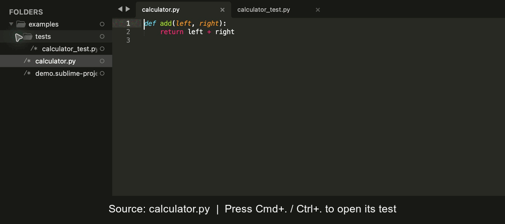

# Sublime Text Code Test Switcher

Jump between a Python source file and its **automated test file** in Sublime Text.
Here, a “test” is code that checks your program's behavior: for example,
`calculator.py` implements addition and `tests/calculator_test.py` checks that
`add(2, 3)` returns `5`.

The plugin also copies a command for running a Python test method or class with
[Testify](https://github.com/Yelp/Testify). It does **not** run tests itself.
Switching files works without Testify installed.



## Quick start

1. Install the plugin (see below).
2. Open your **project folder** in Sublime Text with **File → Open Folder…**.
   Opening just an individual file does not give the plugin a folder to search.
3. Open a saved Python file, such as `calculator.py`.
4. Press **⌘.** on macOS or **Ctrl+.** on Windows/Linux to open
   `calculator_test.py`. Press it again in the test file to return to the source.

You can also open the Command Palette and search for **Code Test Switcher**.

### Which files match?

The plugin searches all open project folders recursively by filename. The source
and test can live in different subfolders:

```text
my-project/
├── calculator.py
└── tests/
    └── calculator_test.py
```

| Current file | Searched filenames |
| --- | --- |
| `calculator.py` | `calculator_test.py` |
| `calculator.tmpl` | `calculator_test.py` |
| `calculator_test.py` | `calculator.py` or `calculator.tmpl` |

The supported test naming convention is **`name_test.py`**. Names such as
`test_name.py` are not matched. `.tmpl` support is for HTML templates; the switching
shortcut is active in Python and HTML syntax. If a template uses another syntax,
use the Command Palette. Other source languages are not supported.

If several matching files exist, a list of full paths lets you choose one;
**Escape** cancels. Hidden subfolders such as `.git` are skipped. If no match
exists, the plugin displays a message; it does not create a new file.

## Copy a Testify command

For this saved file at `tests/calculator_test.py` inside the open project folder:

```python
from testify import TestCase, assert_equal
from calculator import add


class CalculatorTest(TestCase):
    def test_add(self):
        assert_equal(add(2, 3), 5)  # Put the cursor here.
```

| Action | macOS | Windows / Linux | Copied text |
| --- | --- | --- | --- |
| Switch source ↔ test | ⌘. | Ctrl+. | — |
| Copy method command | ⌘, | Ctrl+, | `testify tests.calculator_test CalculatorTest.test_add` |
| Copy class command | ⌘⇧, | Ctrl+Shift+, | `testify tests.calculator_test CalculatorTest` |

Place the cursor on the `def test_add(self):` line or in its body to copy the
method command. For a class command, you can also place it on the class line.
The generated command appears in the status bar and is copied to the clipboard.
Paste it into a terminal at the project root to run it with Testify installed.

Command generation supports the traditional Testify layout shown above:
`class Name(Base):` and `def test_name(self):`. It searches backwards from the
cursor for these declarations. Pytest-style standalone functions, async tests,
and annotated or multiline declarations are not supported by this command helper.
It is not a general Python scope parser. File switching is independent of the
chosen test runner.

For multiple open project folders, the command's module path is relative to the
folder containing the file; the most specific folder wins if they are nested.

## Installation

With [Package Control](https://packagecontrol.io/), run **Package Control: Install
Package** from the Command Palette and choose **CodeTestSwitcher**.

For a manual installation or development checkout, choose **Preferences → Browse
Packages…** and clone this repository inside that directory:

```sh
git clone https://github.com/maltize/sublime-text-code-test-switcher.git CodeTestSwitcher
```

Typical `Packages` locations:

- macOS: `~/Library/Application Support/Sublime Text/Packages/`
- Windows: `%APPDATA%/Sublime Text/Packages/`
- Linux: `~/.config/sublime-text/Packages/`

Use one installation method to avoid loading duplicate copies of the commands.

## Try the included example

Open [`examples/demo.sublime-project`](examples/demo.sublime-project) with
**Project → Open Project…**, or from a terminal in this repository:

```sh
subl --project examples/demo.sublime-project examples/calculator.py
```

1. Press **⌘.** / **Ctrl+.**: `tests/calculator_test.py` should open.
2. Press it again: `calculator.py` should open.
3. Return to the test, put the cursor inside `test_add`, then press **⌘,** /
   **Ctrl+,**. Paste into an empty scratch buffer to check for
   `testify tests.calculator_test CalculatorTest.test_add`.
4. Repeat with **⌘⇧,** / **Ctrl+Shift+,** for
   `testify tests.calculator_test CalculatorTest`.
5. Open **View → Show Console** and check that loading the plugin produces no
   `SyntaxWarning` or traceback.

The example is for navigation and command copying; executing its tests requires
Testify in your project's Python environment.

## Development checks

The regression suite uses standard-library API doubles and needs no Sublime Text
or Testify installation. It checks warning-free compilation, file matching,
project paths, file selection, and clipboard commands:

```sh
python3 -W error -m unittest discover -s tests -v
```

The GIF is captured from the included example in Sublime Text; see
[`docs/demo.md`](docs/demo.md) for the recording steps.

## Maintainers

- [Maciej Gajek](https://github.com/maltize)
- [Grzegorz Smajdor](https://github.com/gs)

Please [open an issue](https://github.com/maltize/sublime-text-code-test-switcher/issues)
if you find a problem or would like a change.
